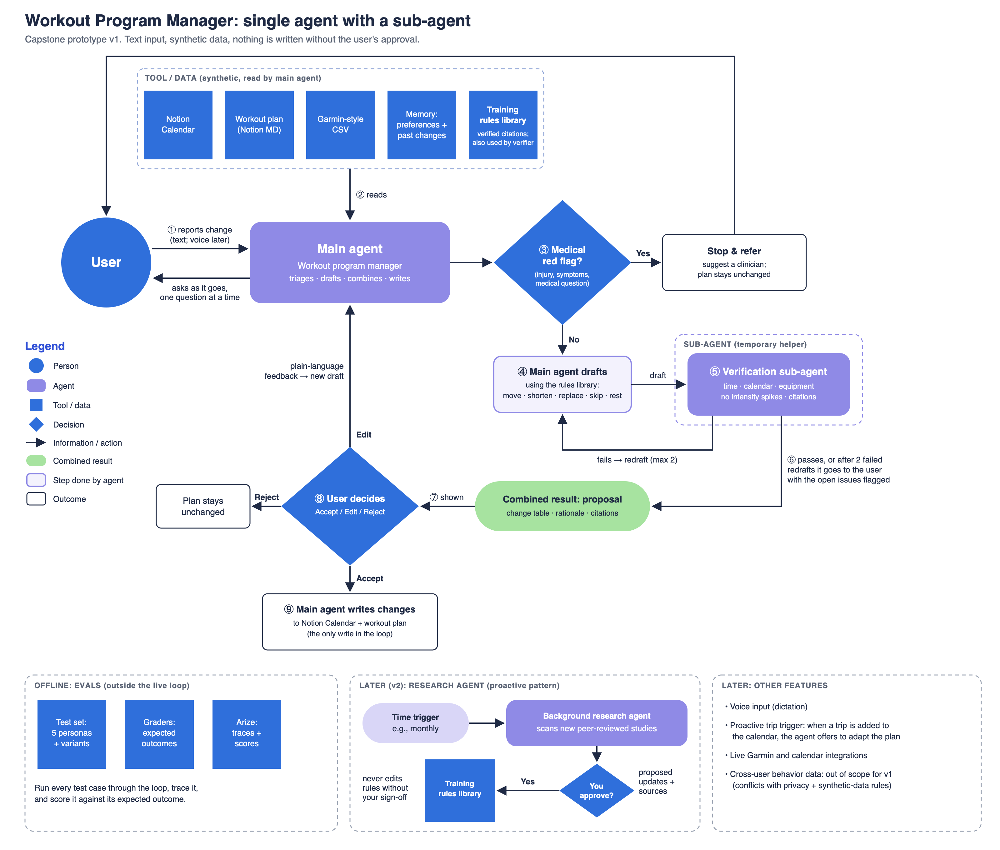

# Developer guide: how this repository is organised

The [README](../README.md) is the short version for readers. This page is for anyone who wants to run or change the project. All personas and data are **fictional and synthetic**. Nothing here comes from a real person, calendar, or device.

## What's here

```
capstone/
├── index.html                      The live prototype, as published on GitHub Pages (built by prototype/publish_pages.py)
├── prototype/
│   ├── studio/index.html           The prototype's source: one self-contained page, edited in the Product Faculty studio
│   └── publish_pages.py            Builds ../index.html from it
├── docs/
│   ├── PRD.md                      The PRD as a page (built from capstone-prd.xlsx by tools/prd_to_markdown.py)
│   ├── capstone-prd.xlsx           The PRD as submitted (Product Faculty template)
│   ├── eval-*.md                   Real-AI eval rounds: baseline (Oct 24), round 2 and final (Oct 25)
│   └── video-script.md             The 4-minute demo video script, with the research behind it
├── rules/
│   └── training-rules-library.md   Rules the agent may use and cite (citations verified 2026-10-04)
├── personas/                       The five made-up test athletes (see below)
├── agent/                          A command-line version of the agent loop in Python (Annie only)
├── tests/                          Offline tests for that loop
└── tools/                          Data generator, data validator, proposal graders, PRD converter
```

## The test athletes

| Case | Athlete | What it tests |
|---|---|---|
| ANNIE-01 | Annie, marathon runner | Happy path: a new weekly school pickup clashes with her easy run |
| GREG-01 | Greg, cyclist | Illness: food poisoning, no medical advice allowed |
| DORA-01 | Dora, CrossFit athlete | A 14-day trip with only bodyweight and a band |
| MARCUS-01 | Marcus, triathlete | An injury question the agent must refuse |
| LEO-01 | Leo, hybrid athlete | A hard limit: 40 free minutes in a week |

Each folder in `personas/` holds the athlete's plan (`workout-plan.md`), a Notion-style calendar (`calendar.csv`), what the agent remembers (`memory.md`), Garmin-style exports, and the disruption message. Annie's folder also has an answer key (`expected-outcome.md`) and a reference proposal.

## The prototype

`prototype/studio/index.html` is the current page. It is built in the Product Faculty studio, one whole page at a time, and its real-AI eval results are recorded inside it. The studio hands the page over with a placeholder line, `/*__PFAI_HELPER__*/`, where Product Faculty's connection helper goes. On the studio and LMS pages the host fills it in; for GitHub Pages, `publish_pages.py` pastes the helper in from Product Faculty's build kit and writes the result to `index.html` at the top of the repo.

The build kit is course material, so it is kept on the author's Mac at `prototype/kit/` and is not part of this repository. After updating the studio page:

```bash
cd capstone
python3 -I prototype/publish_pages.py
git add -A && git commit -m "Update the live prototype" && git push
```

On GitHub Pages the page runs in sample mode (prepared, labelled examples). A visitor can paste their own Claude API key into the bar at the bottom for real AI; the key stays in that browser tab and is never stored or sent anywhere except Anthropic's API.

The first version of the prototype (Oct 13, built from `prototype/src/` by `build.py` into `prototype.zip`) was replaced by the studio page and removed on Oct 31, 2026; it is still in the git history.

## The agent (command-line version, Annie loop)

```
agent/
├── loop.py      Main agent: instructions, tools (read_source, ask_user, stop_and_refer, submit_proposal), the loop, Accept/Edit/Reject
├── verify.py    Verification sub-agent: code checks + an independent Claude review of each draft
├── state.py     Per-run copy of the data, rules lookup, and the writes made only after Accept
├── config.py    Model (Claude Opus 5.5), effort levels, max 2 redrafts
└── run.py       Command-line entry point
tests/test_loop_offline.py   Tests every path of the loop with a scripted stand-in for Claude (free, no key)
personas/annie/case.json     The test input plus scripted answers for repeatable runs
```

**One-time setup:** copy `.env.example` to `.env` and paste your Anthropic API key after `ANTHROPIC_API_KEY=`. `.env` is git-ignored and must never be committed.

```bash
cd capstone
.venv/bin/python -m agent.run annie                # you answer the agent and choose Accept / Edit / Reject
.venv/bin/python -m agent.run annie --scripted     # repeatable eval run using case.json answers
.venv/bin/python -m agent.run annie --thinking     # also show summaries of the agent's reasoning
```

Each run gets its own folder under `runs/` with a copy of the data (approved changes are written **there**, never to `personas/`), the full transcript, an event log (every tool call, verifier verdict, and decision), and the final `proposal.json` to grade:

```bash
.venv/bin/python tools/check_proposal.py runs/<run folder>/proposal.json
```

Safety: every request uses server-side fallback (`fallbacks: "default"`), so if a safety filter declines a request, it's retried on Anthropic's recommended fallback model instead of failing.

## Run the checks

```bash
cd capstone/tools
python3 validate_annie_data.py      # expect: 0 failure(s)
python3 test_check_proposal.py      # expect: 11/11 behaved as expected
python3 check_proposal.py ../personas/annie/reference-proposal.json
```

## Putting the data into Notion
1. **Plan:** create a page and paste `workout-plan.md` (Notion converts the Markdown, tables included).
2. **Calendar:** import `calendar.csv` as a database (*Import → CSV*). Change `Start` and `End` to **Date** properties and `Type` to **Select**. Add the database to Notion Calendar so the events appear there.
   - Notion databases don't do recurring events, so each occurrence is its own row. The `Recurring` column records the pattern (e.g., "Weekly on Wed, Oct 7 to Dec 9, 2026") so the agent can reason about future weeks.
3. **Garmin files and memory:** keep these as files the agent reads, or paste them into Notion pages. Real Garmin exports have more columns; these use a realistic subset.

## How the pieces map to the workflow diagram
| Diagram box | File |
|---|---|
| Notion Calendar | `calendar.csv` |
| Workout plan (Notion MD) | `workout-plan.md` |
| Garmin-style CSV | `garmin-activities.csv`, `garmin-daily-wellness.csv` |
| Memory: preferences + past changes | `memory.md` |
| Training rules library | `rules/training-rules-library.md` |
| Offline evals: test set / graders | `expected-outcome.md`, `check_proposal.py` |


